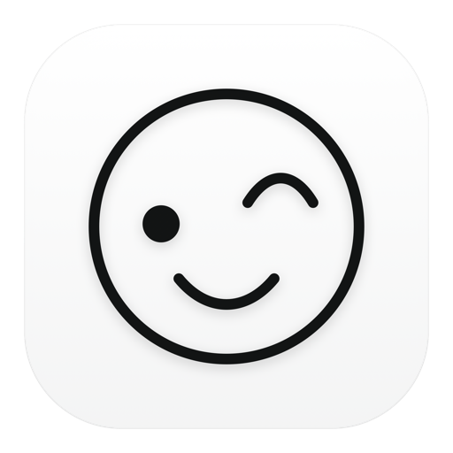

# Pisca Pisca



App de barra de menus para macOS que aplica a regra **20-20-20**: a cada 20 minutos de ecrã, olhar durante 20 segundos para algo a cerca de 6 metros (20 pés). O nome é o que fazes com os olhos enquanto descansas a vista.

- Nativa em Swift + AppKit: **~0,7 MB** de disco e **~15 MB** de memória (nada de Electron)
- Vive apenas na barra de menus, sem ícone no Dock
- Contagem decrescente no ícone e ecrã de pausa a preencher o monitor (ou cartão discreto no canto)
- Pausa em ecrã inteiro ou modo discreto, tempos configuráveis (10-60 min / 20-60 s)
- Interface em **português e inglês**, com seletor no menu
- Arranque automático com o Mac
- Sem ficheiros no disco: as preferências ficam apenas em `UserDefaults`

## Instalar

Requer macOS 13 ou superior e as Xcode Command Line Tools (`xcode-select --install`).

```bash
git clone https://github.com/gabrielmaria/pisca-pisca.git
cd pisca-pisca
./build.sh --install
```

A app fica em `/Applications/PiscaPisca.app` (aparece como **Pisca Pisca** no sistema) e arranca de imediato.

## Utilizar

Clique no ícone do olho na barra de menus:

| Opção | Descrição |
| --- | --- |
| Pausar / retomar lembretes | Suspende temporariamente o ciclo |
| Fazer uma pausa agora | Inicia já os 20 segundos de descanso |
| Tempo de trabalho | 10, 15, 20, 25, 30, 45 ou 60 minutos |
| Duração da pausa | 20, 30, 45 ou 60 segundos |
| Pausa em ecrã inteiro | Alterna entre ecrã inteiro e cartão discreto |
| Iniciar com o Mac | Regista/remove o item de início de sessão |
| Idioma / Language | Português ou inglês |

Durante uma pausa, clique em qualquer lugar para a terminar mais cedo.

---

# English

A macOS menu bar app that enforces the **20-20-20 rule**: every 20 minutes of screen time, look at something about 6 metres (20 feet) away for 20 seconds.

- Native Swift + AppKit: **~0.7 MB** on disk and **~15 MB** of RAM (no Electron)
- Menu bar only, no Dock icon
- Countdown in the menu bar and a full-screen break, or a discreet corner card
- Configurable timings (10-60 min / 20-60 s)
- **English and Portuguese** UI, switchable from the menu
- Launches at login
- No files on disk: preferences live in `UserDefaults` only

## Install

Requires macOS 13+ and the Xcode Command Line Tools (`xcode-select --install`).

```bash
git clone https://github.com/gabrielmaria/pisca-pisca.git
cd pisca-pisca
./build.sh --install
```

The app is installed to `/Applications/PiscaPisca.app` (shown as **Pisca Pisca**) and launched right away.

## Project layout

```
Sources/main.swift     app source (AppKit, no dependencies)
Resources/Info.plist   bundle metadata (LSUIElement = true)
Resources/AppIcon.icns app icon
tools/makeicon.swift   regenerates the icon: swiftc -O -o makeicon tools/makeicon.swift
                       ./makeicon icon.png [mono|green]
build.sh               builds and optionally installs the app
```
